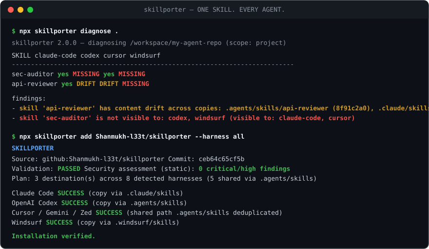

<div align="center">
  <br />
  <a href="https://www.skillporter.dev">
    <picture>
      <source media="(prefers-color-scheme: dark)" srcset="https://raw.githubusercontent.com/Shanmukh-l33t/skillporter/main/website/public/brand/skillporter-lockup.png" />
      <source media="(prefers-color-scheme: light)" srcset="https://raw.githubusercontent.com/Shanmukh-l33t/skillporter/main/website/public/brand/skillporter-lockup-light.png" />
      
    </picture>
  </a>
  <br /><br />
  <p><strong>ONE SKILL. EVERY AGENT.</strong></p>
  <p>The package manager, dependency resolver, and supply-chain security layer for AI agent skills.</p>

  <p>
    <a href="https://pypi.org/project/skillporter/"></a>
    <a href="https://www.npmjs.com/package/@shanmukhdheekonda/skillporter"></a>
    <a href="https://github.com/Shanmukh-l33t/skillporter/actions/workflows/ci.yml"></a>
    <a href="https://github.com/Shanmukh-l33t/skillporter/blob/main/docs/harnesses/README.md"></a>
    <a href="https://github.com/Shanmukh-l33t/skillporter/blob/main/pyproject.toml"></a>
    <a href="https://github.com/Shanmukh-l33t/skillporter/blob/main/LICENSE"></a>
  </p>

  <p>
    <a href="https://www.skillporter.dev"><strong>Website</strong></a> ·
    <a href="https://www.skillporter.dev/docs"><strong>Documentation</strong></a> ·
    <a href="https://www.skillporter.dev/install"><strong>Install</strong></a> ·
    <a href="#harness-support-matrix-19-harnesses"><strong>19 Harnesses</strong></a> ·
    <a href="https://www.skillporter.dev/docs/security"><strong>Security</strong></a> ·
    <a href="#mcp-server"><strong>MCP Server</strong></a> ·
    <a href="https://www.skillporter.dev/faq"><strong>FAQ</strong></a> ·
    <a href="https://www.skillporter.dev/blog"><strong>Blog</strong></a>
  </p>
</div>

---

# Skillporter

**Skillporter, is the package manager for AI agent skills.** It is a zero runtime dependency CLI and MCP server that installs, pins, audits, synchronizes and rolls back `SKILL.md` packages across 19 AI coding and autonomous agent harnesses, including Claude Code, OpenAI Codex, Cursor, Windsurf, GitHub Copilot, Gemini CLI, Hermes Agent, OpenHands and Goose.

```bash
uvx skillporter diagnose .                        # run the CLI without installing it (uv)
pipx install skillporter                          # install the CLI globally (PEP 668 safe)
npx @shanmukhdheekonda/skillporter diagnose .     # run the CLI without installing it (npm)
```

<p align="center">
  <a href="https://www.skillporter.dev">
    
  </a>
</p>

---

## Why skills need a package manager

Every AI agent harness reads skills from a different directory (`.claude/skills/`, `.agents/skills/`, `.github/skills/`, `.windsurf/skills/`, `$HERMES_HOME/skills/`, `~/.openclaw/skills/`), and each one resolves them differently.

- A skill placed in `.claude/skills/` is invisible to OpenAI Codex, Gemini CLI, Zed, and Windsurf.
- Hand-rolled symlinks break inside Docker builds, CI checkouts, `git worktree`, and Windows checkouts.
- Manual copies across directories silently drift out of sync across teammates, while naive removals from shared `.agents/skills/` directories break other agents.
- An upstream skill can change under you between two `sync` runs, and an agent loads whatever it finds into its system context.

Skillporter treats skills the way a package manager treats dependencies: one manifest, one lockfile, one resolution step, and one install path that every harness can read.

## What Skillporter does

| Capability | How it works |
|---|---|
| **Universal source resolution** | Fetches from GitHub shorthand (`owner/repo`), Git URLs, local paths, or archives without executing bundled scripts. |
| **Shared-path deduplication** | Writes `.agents/skills/<skill>` once across 8 primary harnesses and preserves it during single-harness `remove`. |
| **Static supply-chain assessment** | Inspects Python ASTs, JS/TS, Markdown instructions, and bounded Base64/Hex/PowerShell payloads before any file is written. |
| **Deterministic lockfiles** | Pins `resolved_commit`, `tree_hash`, per-file SHA-256 `file_hashes`, and `pin_state` in `skillporter.lock`. |
| **Portable `.skillpack` environments** | Packages managed skills, provenance, lockfiles, and profiles into a SHA-256 verified offline archive (`export` / `import` / `diff`). |
| **Granular harness & profile control** | Supports `--exclude-harness`, `--isolated`, `--on-conflict`, `move`, `adopt`, `harness` inspection, and named `profile` switching. |
| **Crash-safe transactions** | Stages multi-harness installs behind a write-ahead `journal.json` and snapshots replaced copies into `.skillporter/backups/`. |
| **Agent skill & hardened MCP server** | Ships an official `skillporter` skill (`self-skill install`) plus a workspace-bounded JSON-RPC 2.0 MCP server (`--allow-writes` opt-in). |

## Installation

```bash
# Option A: run immediately without a global install, via uvx or npx
uvx skillporter diagnose .
npx @shanmukhdheekonda/skillporter diagnose .

# Option B: install from PyPI with uv or pipx (PEP 668 safe)
uv tool install skillporter
pipx install skillporter

# Option C: standalone verified release installer (Linux and macOS)
# Verifies SHA256SUMS.txt and the GitHub OIDC provenance attestation
# (`gh attestation verify`) or an out-of-band pinned digest
# (`SKILLPORTER_SHA256=<64-hex>`). Never falls back to mutable `main`.
curl -fsSL https://github.com/Shanmukh-l33t/skillporter/releases/download/v3.0.1/install.sh -o install.sh
SKILLPORTER_VERSION=v3.0.1 sh install.sh
```

Python 3.9 or newer is required, and the standalone installer checks for it before unpacking anything. The package ships with no runtime dependencies, so there is nothing else to audit or pin.

## Quick start (60 seconds)

```bash
# 1. Run the zero residue interactive demo (heals broken symlinks and SHA-256 drift in a temp dir)
skillporter demo

# 2. Install a skill across harnesses (validates spec, runs static security scan, deduplicates .agents/skills)
skillporter add anthropics/skills --skill pdf --harness all

# 3. Inspect and security scan skills (text, JSON, or SARIF 2.1.0 for GitHub Code Scanning)
skillporter scan .
skillporter scan . --format sarif > skillporter.sarif

# 4. Initialize manifest, synchronize transitive dependencies, and verify the reproducible lockfile in CI
skillporter init
skillporter sync
skillporter lock --check

# 5. Diagnose reachability, audit provenance and override logs, or roll back to a verified snapshot
skillporter status
skillporter audit .
skillporter rollback pdf

# 6. Export, compare, and restore your entire skill environment across machines (works offline)
skillporter export my-environment.skillpack
skillporter diff my-environment.skillpack
skillporter import my-environment.skillpack --dry-run

# 7. Give your AI coding agents native control over Skillporter
skillporter self-skill install --harness detected
```

## Supply chain security

Agent skills are untrusted supply chain packages: an agent loads `SKILL.md` directly into its system context and executes bundled scripts. Skillporter is built around that assumption rather than around convenience.

- **Silent skill drift and unpinned upstream changes**: `skillporter.lock` pins resolved Git commits, SHA-256 tree digests, and per-file hashes, blocking unexpected upstream mutations during `sync`.
- **Known static supply chain hazards**: inspects Python ASTs, JavaScript and TypeScript scripts, Markdown instructions, and bounded Base64, Hex and PowerShell payloads for embedded credentials, prompt injection override patterns, hidden Unicode and comments, shell pipe RCE, unsafe deserialization, symlink escapes, and multi-file staged execution before installation.
- **Unsafe archive and filesystem operations**: blocks Zip-Slip and Tar-Slip inputs (`../`, `..\`, drive paths, Windows reserved device names, Unicode NFC/NFD collisions, symlinks, special files, decompression bombs) and stages installs transactionally with crash recovery journals.
- **Unscoped agent filesystem writes**: constrains `skillporter mcp` to the workspace root with default-deny write permissions (`SKILLPORTER_MCP_ALLOW_WRITES=1` opt-in) and separates conflict overrides (`--force`) from security risk overrides (`--allow-risky`).

> **Important security note**: static scanning (`STATIC_SECURITY_ASSESSMENT`) inspects files for known dangerous patterns and structural anomalies. **A clean static scan is not proof that a skill is safe at runtime.** Novel natural-language prompt injections or dynamically fetched payloads can still steer an agent at runtime.

How the scan is graded and where its limits are is documented in [SECURITY.md](https://github.com/Shanmukh-l33t/skillporter/blob/main/SECURITY.md).

## Lockfile, sync and rollback

`skillporter.lock` is the reproducible record of what is installed:

- Pins `resolved_commit`, `tree_hash`, per-file SHA-256 `file_hashes`, `pin_state` (`PINNED_COMMIT`, `PINNED_CONTENT` or `UNPINNED_MUTABLE`), dependencies, and adapter version.
- `skillporter sync` honors locked Git commit SHAs even when upstream branches move, and rejects unexpected upstream content changes without `--force`.
- `skillporter lock --check` verifies the lockfile in CI and fails on mismatch.
- `skillporter audit` reports installed origins, lockfile drift, and `.skillporter/audit.jsonl` events, so any risk override is visible after the fact.

Rollback is transactional rather than a re-download. Replacements are staged in `.skillporter/tmp/txn-*` behind a write-ahead `journal.json`, prior versions are snapshotted into `.skillporter/backups/`, and `skillporter rollback` restores a skill together with its dependency graph from SHA-256 verified backups.

## Harness support matrix (19 harnesses)

Skillporter distinguishes **support status** (`NATIVE`, `COMPATIBLE`, `ADAPTED`) from **verification evidence** (`RUNTIME_VERIFIED`, `INTEGRATION_TESTED`, `FIXTURE_TESTED`, `DOCUMENTATION_VERIFIED`). An adapter is never marked `RUNTIME_VERIFIED` unless it has been tested against a live harness runtime.

| Harness | Project Path | User / Global Path | Support | Verification Evidence |
|---|---|---|---|---|
| **Hermes Agent** | `.hermes/skills/` | `$HERMES_HOME/skills/<cat>/<name>` | `NATIVE` | `RUNTIME_VERIFIED` |
| **Claude Code** | `.claude/skills/` | `~/.claude/skills/` | `NATIVE` | `INTEGRATION_TESTED` |
| **OpenAI Codex** | `.agents/skills/` | `~/.agents/skills/` | `NATIVE` | `INTEGRATION_TESTED` |
| **Cursor** | `.agents/skills/`, `.cursor/skills/` (+2 compat) | `~/.agents/skills/`, `~/.cursor/skills/` | `NATIVE` | `INTEGRATION_TESTED` |
| **GitHub Copilot** | `.github/skills/` (+2 compat) | `~/.copilot/skills/` (+1 compat) | `NATIVE` | `FIXTURE_TESTED` |
| **Gemini CLI** | `.agents/skills/`, `.gemini/skills/` | `~/.agents/skills/`, `~/.gemini/skills/` | `NATIVE` | `FIXTURE_TESTED` |
| **Google Antigravity** | `.agents/skills/` (+1 compat) | `~/.gemini/config/skills/` | `NATIVE` | `FIXTURE_TESTED` |
| **Windsurf** | `.windsurf/skills/` | `~/.codeium/windsurf/skills/` | `NATIVE` | `FIXTURE_TESTED` |
| **Cline** | `.cline/skills/` (+3 compat) | `~/.cline/skills/` | `NATIVE` | `FIXTURE_TESTED` |
| **Roo Code** | `.roo/skills/` (+1 compat) | `~/.roo/skills/` (+1 compat) | `NATIVE` | `FIXTURE_TESTED` |
| **OpenCode** | `.opencode/skills/` (+2 compat) | `~/.config/opencode/skills/` (+2 compat) | `NATIVE` | `FIXTURE_TESTED` |
| **Zed** | `.agents/skills/` | `~/.agents/skills/` | `NATIVE` | `FIXTURE_TESTED` |
| **Replit Agent** | `.agents/skills/` (+1 compat) | `~/.config/agents/skills/` | `NATIVE` | `FIXTURE_TESTED` |
| **JetBrains Junie** | `.junie/skills/` (+1 compat) | `~/.junie/skills/` (+1 compat) | `NATIVE` | `FIXTURE_TESTED` |
| **OpenClaw** | `.openclaw/skills/` (+2 compat) | `~/.openclaw/skills/` (+1 compat) | `NATIVE` | `FIXTURE_TESTED` |
| **OpenHands** | `.agents/skills/` (+2 compat) | `~/.agents/skills/` (+1 compat) | `NATIVE` | `FIXTURE_TESTED` |
| **Goose** | `.agents/skills/` (+1 compat) | `~/.agents/skills/` (+1 compat) | `NATIVE` | `FIXTURE_TESTED` |
| **Continue** | `.continue/skills/` (`.continue/rules/` adapted) | `~/.continue/skills/` | `COMPATIBLE` | `FIXTURE_TESTED` |
| **Aider / AiderDesk** | `.aider-desk/skills/` (`CONVENTIONS.md` adapted) | `~/.aider-desk/skills/` | `ADAPTED` | `FIXTURE_TESTED` |

Each harness record ships its detection rules, path precedence, and vendor documentation reference. `skillporter matrix` prints the same matrix from the installed CLI, and `skillporter detect` reports which harnesses exist on the current machine.

## MCP server

`skillporter mcp` runs a hardened JSON-RPC 2.0 Model Context Protocol server so an agent can query a workspace instead of shelling out. It exposes 13 tools (`diagnose`, `detect`, `scan`, `inspect`, `matrix`, `status`, `diff`, `add`, `install`, `sync`, `remove`, `export`, `import`), is read-only by default, refuses paths outside the workspace root, and requires an explicit opt-in before any write tool becomes available:

```bash
skillporter mcp                                   # read-only
skillporter mcp --allow-writes                    # enable write tools
SKILLPORTER_MCP_ALLOW_WRITES=1 skillporter mcp    # same, via the environment
```

Client setup for Claude Code and other MCP clients is covered in the [MCP guide](https://www.skillporter.dev/docs/mcp).

## CLI reference

| Command | Description |
|---|---|
| `skillporter status [path]` | Unified environment control center: manifest, lockfile, profiles, managed vs. unmanaged skills, and drift |
| `skillporter export [file.skillpack]` | Package managed skills, provenance, lockfile, and profiles into a SHA-256 verified portable `.skillpack` archive |
| `skillporter import <file.skillpack>` | Validate integrity, run static security checks, preview conflicts (`--dry-run`), and restore an environment offline |
| `skillporter diff <target>` | Compare current workspace against a `.skillpack` archive, project directory, or `profile:<name>` |
| `skillporter profile <action>` | Create (`save`), inspect (`list`, `show`), switch (`use --prune`), or remove (`delete`) named skill profiles |
| `skillporter harness <action>` | List, inspect capabilities and shared peers, or check status across all 19 supported harnesses |
| `skillporter add <source>` | Resolve, validate, security scan, and install skills (`--exclude-harness`, `--on-conflict`, `--isolated`, `--dry-run`) |
| `skillporter install <dir>` | Security scan and install a local skill directory (`--exclude-harness`, `--on-conflict`, `--isolated`, `--dry-run`) |
| `skillporter move <skill>` | Relocate an installed skill across harnesses safely (`--from`, `--to`, `--isolated`, `--dry-run`) |
| `skillporter adopt [skills]` | Bring existing unmanaged on-disk skills under Skillporter tracking, backup, and export (`--all`) |
| `skillporter remove <skill>` | Safely remove a skill while preserving shared `.agents/skills/` still owned by other harnesses (`--dry-run`, `--json`) |
| `skillporter sync [path]` | Resolve pinned and transitive dependencies, verify lockfile hashes, and synchronize harnesses (`--dry-run`, `--json`) |
| `skillporter outdated [skill]` | Check managed skills against upstream versions and SHA-256 tree hashes without modifying files |
| `skillporter update [skill]` | Fetch, security gate, back up, and update tracked skills (`--dry-run`, `--allow-risky`, `--json`) |
| `skillporter rollback <skill>` | Atomically restore a skill and its dependency graph from SHA-256 verified `.skillporter/backups/` (`--dry-run`, `--json`) |
| `skillporter lock [path] [--check]` | Write or CI verify (`--check`) the deterministic `skillporter.lock` |
| `skillporter scan [path]` | Run static security and supply chain assessment (`--format text\|json\|sarif`, `--max-risk-score`) |
| `skillporter audit [path]` | Inspect installed skill origins, security posture, lockfile drift, and `.skillporter/audit.jsonl` events |
| `skillporter diagnose [path]` | Check reachability, broken symlinks, SHA-256 content drift, duplicates, and spec compliance |
| `skillporter doctor [path] [--fix]` | Comprehensive workspace health check and tamper safe repair (`--dry-run`, `--json`) |
| `skillporter validate [path]` | Validate `SKILL.md` against the Agent Skills specification (`--format text\|json\|sarif`) |
| `skillporter inspect <source>` | Inspect local or remote package structure, security posture, and adapted rule previews |
| `skillporter graph [path]` | Render or export (`--json`) the topological skill dependency graph |
| `skillporter self-skill [install]` | Bootstrap the official `skillporter` AI agent skill into detected or selected harnesses |
| `skillporter sandbox run <skill>` | **[Experimental]** Opt in, non-mutating dry run behavioral trace |
| `skillporter explain <finding>` | Explain any diagnostic, lockfile, validation, or `sec-*` finding code with remediation commands |
| `skillporter search / info / pack / publish` | Search the catalog, inspect metadata, build a deterministic `.tar.gz` with `provenance.json`, or publish |
| `skillporter detect / matrix / demo` | Detect installed harnesses, print the 19 harness matrix, or run the zero residue demo |
| `skillporter mcp` | Run the hardened JSON-RPC 2.0 MCP server (read-only by default; `--allow-writes` opt in) |

### Exit codes

- `0`: clean, or the operation succeeded
- `1`: policy or diagnostic finding (drift, broken symlink, spec error, security block, lockfile mismatch, cycle or conflict)
- `2`: usage or runtime error (invalid argument, unknown harness, missing path)

## Documentation

- [Website](https://www.skillporter.dev): overview, interactive terminal demo, and live 19-harness matrix.
- [Documentation home](https://www.skillporter.dev/docs): the full guide set, from installation through lockfiles, scanning, and CI.
- [Install](https://www.skillporter.dev/install): installation channels and provenance verification options.
- [FAQ](https://www.skillporter.dev/faq): frequently asked questions.
- [Blog](https://www.skillporter.dev/blog): engineering articles and release write-ups.

The same guides are versioned in the repository under [`docs/`](https://github.com/Shanmukh-l33t/skillporter/tree/main/docs) if you prefer to read them on GitHub.

## Contributing

Issues and pull requests are welcome. The short version:

- Open an issue before starting a large architectural change.
- New harness adapters must link the vendor documentation that proves the skill discovery path, and must not claim a verification level that has not been tested.
- The core library stays on the Python standard library, with zero runtime dependencies.

Full setup instructions, the required local quality gates, and the adapter checklist are in [CONTRIBUTING.md](https://github.com/Shanmukh-l33t/skillporter/blob/main/CONTRIBUTING.md). To report a vulnerability, follow [SECURITY.md](https://github.com/Shanmukh-l33t/skillporter/blob/main/SECURITY.md) instead of opening a public issue.

## License

MIT. See [LICENSE](https://github.com/Shanmukh-l33t/skillporter/blob/main/LICENSE).
